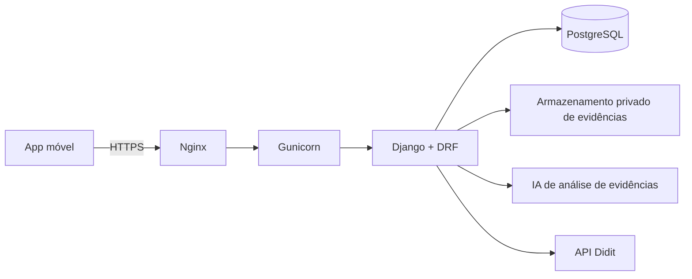

# Violet 💜

### Aplicativo de denúncia e proteção à mulher no ambiente acadêmico

---

## Tema: Igualdade de Gênero no Ambiente Acadêmico

A igualdade de gênero é um tema central nas discussões contemporâneas sobre direitos humanos e justiça social. No ambiente acadêmico, essa pauta ganha ainda mais relevância, pois escolas e universidades devem ser espaços seguros e inclusivos, onde mulheres possam desenvolver seu potencial sem medo de discriminação ou violência.

Apesar dos avanços legais e institucionais, ainda persistem situações de assédio e abuso que comprometem a integridade e o bem-estar das estudantes. Muitas mulheres enfrentam assédios dentro das escolas e faculdades, tanto de professores quanto de alunos, e, frequentemente, a coordenação dessas instituições prefere não dar visibilidade aos casos e não toma as medidas necessárias. Assim, essas vítimas ficam desamparadas, sem apoio efetivo e sem canais seguros para denunciar.

Uma pesquisa de campo com estudantes universitárias do CEUB (2026) reforça esse cenário:

| Indicador | Resultado |
|---|:---:|
| Se sentem seguras no período noturno | 25% |
| Já presenciaram ou sofreram algum tipo de assédio | 37,5% |
| Se sentem confortáveis para denunciar | 12,5% |
| Utilizariam um aplicativo de segurança para denúncias anônimas | 87,5% |

## A Solução

Diante desse cenário, torna-se evidente a necessidade de ferramentas independentes que garantam proteção e acolhimento às vítimas. Nesse contexto, nasce a ideia de um **aplicativo de denúncias e proteção**.

Inspirado no aplicativo **PenhaS**, referência nacional no enfrentamento à violência contra a mulher, o projeto utiliza essa solução consolidada como benchmarking, adaptando suas funcionalidades ao ambiente acadêmico. O diferencial é permitir o registro de **denúncias anônimas**, com envio de evidências e mecanismos de segurança e privacidade, reduzindo o medo de represálias e oferecendo um canal independente de apoio e proteção.

> O Violet é complementar aos serviços oficiais. Ele **não** substitui serviços de emergência, não realiza investigações policiais, não aplica punições e não oferece diretamente atendimento médico, psicológico ou jurídico.

## Funcionalidades

* **Cadastro, verificação de identidade e login**: a verificação é feita por documento oficial (CNH ou Identidade), com reconhecimento facial e checagem de autenticidade via API Didit, reduzindo acessos indevidos. Também é possível se cadastrar e entrar com Google, Apple ou Facebook (a verificação de identidade continua obrigatória).
* **Botão de emergência inteligente**: ao ser acionado, envia a localização em tempo real, possibilita a gravação de áudio e a captura de fotos ou vídeos, encaminhando essas informações para contatos de confiança e centrais de apoio, como o Ligue 180.
* **Denúncias anônimas com evidências**: permite registrar denúncias sem expor a identidade da usuária, com possibilidade de anexar prints, fotos, áudios e vídeos relacionados à ocorrência.
* **IA para detecção de violência**: toda evidência anexada passa por análise com inteligência artificial, que apoia a identificação e a verificação de possíveis ocorrências, disponibilizando essas informações para as autoridades competentes.
* **Rede de apoio entre usuárias**: permite cadastrar e gerenciar contatos de confiança e compartilhar a localização com eles, auxiliando na segurança em situações de risco.
* **Notificações e conversas**: área de conversas com contatos da rede de apoio e com outras usuárias, incluindo comunicação anônima. Nesse modo, a identidade fica registrada internamente por segurança e controle de acesso, mas não é exibida para a outra participante.
* **Registro de ocorrências**: armazena as denúncias registradas, permite consultar o histórico e possibilita a identificação de possíveis padrões envolvendo professores, funcionários ou alunos.
* **Sistema de orientação e apoio**: disponibiliza informações sobre procedimentos após situações de assédio, direitos das mulheres e canais oficiais de apoio.
* **Segurança e privacidade**: protege as informações das usuárias, denúncias, evidências, mensagens e dados de localização.

## Arquitetura

O detalhamento completo está no documento de Arquitetura de Software do projeto. Resumo das decisões:

| Item | Decisão |
|---|---|
| Linguagem | Python |
| Framework | Django + Django REST Framework (DRF) |
| Padrão arquitetural | MVC |
| Paradigma | Programação Orientada a Objetos |
| Banco de dados | PostgreSQL |
| Servidor | Nginx + Gunicorn, com HTTPS |
| Verificação de identidade | API Didit |
| Modelagem | UML (casos de uso, classes, diagramas lógico e físico) |

### Camadas da visão lógica

| Camada | Implementação no Violet |
|---|---|
| View | Telas do app móvel e Serializers do DRF |
| Controller | Views e ViewSets do DRF: endpoints de denúncias, alertas e autenticação |
| BusinessLogic | Módulos de serviço em Python: orquestração de emergência, integração com IA, anonimato e padrões de ocorrência |
| Action / Model | ModelManagers e métodos de classe das entidades |
| Bean | Entidades em `models.py`: `Usuaria`, `Denuncia`, `Evidencia`, `AlertaEmergencia`, `ContatoConfianca` |
| Persistence | Django ORM com PostgreSQL |

### Atores e casos de uso

**Atores:** Usuária, Contato de confiança e Ligue 180.

| Área | Casos de uso |
|---|---|
| Cadastro e acesso | Cadastrar-se, verificar identidade, realizar login, cadastro e login com Google, Apple ou Facebook |
| Emergência | Acionar botão de emergência, compartilhar localização, gravar áudio, capturar foto ou vídeo, enviar informações de emergência |
| Denúncia | Realizar denúncia anônima, anexar evidências, analisar evidências com IA |
| Orientação e apoio | Consultar orientações, gerenciar rede de apoio, consultar histórico de denúncias |
| Comunicação | Receber notificações, acessar conversas |

Principais relacionamentos: cadastrar-se *inclui* verificar identidade; acionar o botão de emergência *inclui* compartilhar localização e enviar informações; anexar evidências *estende* a denúncia anônima (é opcional) e *inclui* a análise por IA.

### Implantação

- **Cliente:** dispositivo móvel, conexão via HTTPS.
- **Aplicação:** Django/DRF em Gunicorn, atrás de proxy reverso.
- **Banco:** PostgreSQL, acessível apenas pela aplicação e por conexões administrativas autorizadas.
- **Arquivos:** evidências em área privada com acesso controlado, sem links públicos.
- **Ambiente:** variáveis de ambiente para credenciais, backups e registros de operação.

### Qualidade, segurança e privacidade

- HTTPS, senhas com hash seguro, controle de acesso por perfil, validação de entradas e segredos fora do código-fonte.
- Acesso a denúncias e evidências limitado a pessoas autorizadas, com coleta apenas dos dados necessários, em conformidade com a **LGPD**.
- Backups periódicos com teste de restauração.
- Metas de desempenho iniciais: operações comuns respondendo em até 3 segundos, listagens paginadas e mensagens de erro claras, sem expor dados técnicos.
- O sistema explica os limites do anonimato e não promete sigilo absoluto.

## Desenvolvimento

O desenvolvimento do aplicativo Violet foi organizado em **14 Sprints**, com **10 dias de duração cada**. As primeiras três Sprints foram realizadas no primeiro semestre de 2026, contemplando pesquisa, definição de escopo e planejamento técnico. As Sprints seguintes contemplam a construção da estrutura do sistema, funcionalidades de emergência e denúncia, orientação e apoio, rede de apoio, registro de ocorrências, testes, preparação para lançamento e manutenção.

### Roadmap

| Fase | Entregas |
|---|---|
| Requisitos | Delimitar o problema, identificar perfis, mapear requisitos funcionais e não funcionais, definir o escopo |
| Projeto | Validar fluxos, protótipos de alta fidelidade, arquitetura e modelos de dados |
| Base técnica | Repositório, ambiente Django, DRF, PostgreSQL, autenticação e permissões iniciais |
| Funcionalidades centrais | Registro de denúncias, anonimato, anexos privados e mudança de status |
| Experiência e acompanhamento | Telas responsivas, orientações de acolhimento e notificações compatíveis com a privacidade |
| Validação | Testes funcionais, de permissões e de desempenho, revisão de segurança e avaliação com stakeholders |
| Implantação e documentação | Ambiente, HTTPS, backups, documentação de uso e operação e apresentação da versão validada |

### Objetivos

- Entregar a estrutura inicial e as funcionalidades de emergência, denúncia e orientação/apoio até o fim do 2º semestre de 2026 (Sprints 4 a 7).
- Disponibilizar o aplicativo para lançamento com testes de usabilidade e segurança concluídos (Sprints 8 a 14).
- Garantir que ao menos 80% das funcionalidades priorizadas na pesquisa (botão de emergência, denúncia anônima e rede de apoio) estejam implementadas e validadas por usuárias-teste.

## Protótipo

Link do Figma: _adicionar aqui_

## Considerações Finais

A luta pela igualdade de gênero exige ações concretas que garantam segurança e respeito às mulheres em todos os espaços, especialmente no ambiente acadêmico. O problema do assédio, ainda tão presente, não pode ser ignorado ou minimizado pelas instituições.

A criação de um aplicativo de denúncias anônimas, aliado a recursos de emergência, inteligência artificial para detecção de violência, rede de apoio, orientação e mecanismos de segurança e verificação, representa uma solução tecnológica voltada às necessidades identificadas no ambiente acadêmico. Ao se inspirar no PenhaS como benchmarking, o projeto adapta uma solução consolidada às especificidades do contexto escolar e universitário.

Mais do que uma ferramenta tecnológica, trata-se de um passo importante rumo a uma sociedade em que meninas e mulheres possam estudar e crescer livres de medo, fortalecendo o compromisso coletivo com a justiça, a equidade e o bem-estar.

## Trabalhos Relacionados

* [Detecção de Violência em Tempo Real](https://github.com/majuccosta/Violet/blob/main/deteccao-violencia-tempo-real): trabalho complementar sobre detecção automática de situações de violência, aplicável ao contexto de segurança abordado neste projeto.

## Equipe

Laura Venancio Martins, Maria Júlia de Carvalho Costa e Sara Ramos Scalia.

Orientação: Prof. Fabrício Ofuji (parceria de extensão) e Prof. Nikson Bernardes Fernandes Ferreira (protótipo de inteligência artificial).

Projeto de extensão e pesquisa do Centro Universitário de Brasília (CEUB), em parceria com a comunidade Meninas na Ciência do IFB.

---

Em situação de violência ou risco, ligue **180** (Central de Atendimento à Mulher) ou **190** (Polícia Militar). 💜

